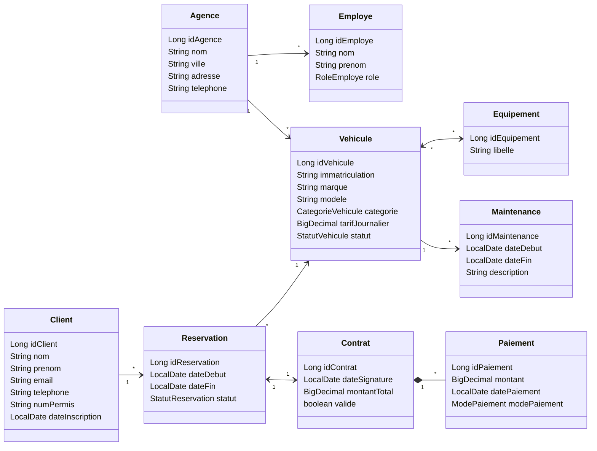

# AutoLoc API

API de gestion de **location de véhicules** développée avec **Spring Boot**, **Spring Data JPA** et **MySQL**, dans le cadre du module *UP ASI : Architecture des Systèmes d'Information* (ESPRIT, ASI 26-27).


---

## Sommaire

1. [Fonctionnalités et avancement](#1-fonctionnalités-et-avancement)
2. [Technologies](#2-technologies)
3. [Prérequis](#3-prérequis)
4. [Installation et lancement](#4-installation-et-lancement)
5. [Architecture du projet](#5-architecture-du-projet)
6. [Modèle de domaine](#6-modèle-de-domaine)
7. [Associations, cascade et fetch](#7-associations-cascade-et-fetch)
8. [Couche Service, IoC et injection de dépendances](#8-couche-service-ioc-et-injection-de-dépendances)
9. [Règles de gestion](#9-règles-de-gestion)
10. [Documentation technique](#10-documentation-technique)
11. [Conventions de code et de commit](#11-conventions-de-code-et-de-commit)
12. [Dépannage](#12-dépannage)
13. [Feuille de route](#13-feuille-de-route)
14. [Auteur](#14-auteur)

---

## 1. Fonctionnalités et avancement

| Atelier | Thème | Contenu | État |
|---|---|---|---|
| 1 | Démarrage Spring Boot + première entité JPA | Projet Maven, connexion MySQL, génération du schéma, 9 entités JPA | Terminé |
| 2 | Associations JPA, cascade et fetch | Associations bidirectionnelles, `mappedBy`, `cascade`, `orphanRemoval`, `LAZY` | Terminé |
| 3 | Couche Repository | Interfaces `I…Repository` (`JpaRepository<Entité, Long>`) | Voir note ci-dessous |
| 4 | IoC, DI et couche Service | 9 services (`I…Service` / `…ServiceImpl`), exception métier, injection par constructeur | Terminé |
| 5 | API REST (contrôleurs) | `web.controller`, tests Postman | À venir |
| 6 | .. | `...` | À venir |

> **Note** : les neuf repositories `I…Repository` sont requis par la couche Service (Atelier 4). Leur présence est confirmée au démarrage par le message `Found 9 JPA repository interfaces`.

---

## 2. Technologies

- **Java 17**
- **Spring Boot** (Spring Web, Spring Data JPA, Validation, DevTools)
- **Hibernate** (ORM, génération automatique du schéma)
- **MySQL** (driver `mysql-connector-j`)
- **Lombok** (`@Getter`, `@Setter`, `@NoArgsConstructor`, `@AllArgsConstructor`, `@RequiredArgsConstructor`)
- **Maven** (wrapper `mvnw` fourni)
- **IntelliJ IDEA**, **Postman**, **SonarQube for IDE** (analyse de la qualité du code)

---

## 3. Prérequis

- JDK 17 ou supérieur
- Maven (ou le wrapper `mvnw` inclus)
- MySQL installé et démarré (port `3306` par défaut)
- Un client SQL (MySQL Workbench, DBeaver ou l'onglet *Database* d'IntelliJ)
- Postman (ou équivalent) pour les ateliers suivants
- Git

---

## 4. Installation et lancement

### 4.1 Cloner le dépôt

```bash
git clone https://github.com/<votre-compte>/AutoLoc.git
cd AutoLoc/autoloc-api
```

### 4.2 Configurer la base de données

La base `autoloc_db` est **créée automatiquement** au premier démarrage grâce au paramètre `createDatabaseIfNotExist=true`. Aucune création manuelle n'est nécessaire.

Fichier `src/main/resources/application.properties` :


### 4.3 Lancer l'application

```bash
./mvnw spring-boot:run
```

Sous Windows : `mvnw.cmd spring-boot:run`. Sous IntelliJ : clic droit sur `AutolocApiApplication.java` → **Run**.

### 4.4 Vérifier le démarrage

Dans la console, vérifier :

- `Found 9 JPA repository interfaces`
- la création des tables (`create table …`)
- `Started AutolocApiApplication in … seconds`

Puis vérifier le schéma :

```sql
USE autoloc_db;
SHOW TABLES;
```

Dix tables sont attendues : les 9 entités, plus la table de jointure `vehicule_equipement`.

> **Attention** : `ddl-auto=update` est réservé au **développement**. En production, utiliser `validate` ou `none` avec un outil de migration (Flyway, Liquibase).

---

## 5. Architecture du projet

```text
autoloc-api
├── docs/
│   ├── fetch-strategy.md          # Atelier 2 : choix de cascade et de fetch
│   └── service-notes.md           # Atelier 4 : IoC, DI et services
├── src/main/java/tn/esprit/autoloc
│   ├── AutolocApiApplication.java
│   ├── domain/                    # Entités JPA et énumérations (Ateliers 1 et 2)
│   ├── repository/                # Interfaces Spring Data JPA : I…Repository (Atelier 3)
│   ├── service/                   # I…Service et …ServiceImpl (Atelier 4)
│   ├── exception/                 # ResourceNotFoundException (Atelier 4)
│   └── web/
│       ├── controller/            # Contrôleurs REST (Atelier 5)
│ 
├── src/main/resources/application.properties
├── src/test/java/tn/esprit/autoloc
└── pom.xml
```

### Architecture multicouche

```text
Controller (Atelier 5)  ──►  I…Service (interface)
                                   ▲ implémentée par
                             …ServiceImpl (@Service)
                                   │ injecte
                                   ▼
                             I…Repository (interface)
                                   ▲ proxy généré par Spring Data
                        SimpleJpaRepository ─► Hibernate ─► MySQL
```

Règles de la architecture :

- Le contrôleur ne s'adresse **jamais** directement au repository : il passe par le service.
- Chaque couche dépend de **l'interface** de la couche inférieure, jamais de son implémentation.
- Le service porte la logique métier ; il ne connaît ni HTTP ni JSON.

---

## 6. Modèle de domaine

Le modèle comprend **9 entités** et **5 énumérations**.



### Énumérations

| Énumération | Valeurs |
|---|---|
| `StatutVehicule` | `DISPONIBLE`, `LOUE`, `MAINTENANCE` |
| `CategorieVehicule` | `CITADINE`, `BERLINE`, `SUV`, `UTILITAIRE` |
| `RoleEmploye` | `AGENT`, `MANAGER` |
| `StatutReservation` | `EN_ATTENTE`, `CONFIRMEE`, `ANNULEE`, `TERMINEE` |
| `ModePaiement` | `CARTE`, `ESPECES`, `VIREMENT` |

### Choix de mapping

- Clé primaire : `@GeneratedValue(strategy = GenerationType.IDENTITY)` (colonne `AUTO_INCREMENT` de MySQL).
- Énumérations stockées en texte : `@Enumerated(EnumType.STRING)`.
- Montants : `BigDecimal` avec `precision = 10, scale = 2`.
- Lombok **ciblé** (`@Getter` / `@Setter`), **jamais `@Data`** sur les entités : avec les associations bidirectionnelles, `equals`, `hashCode` et `toString` provoqueraient des boucles infinies (`StackOverflowError`).

---

## 7. Associations, cascade et fetch

Tous les `@ManyToOne` et `@OneToOne` sont forcés en `LAZY` (le défaut JPA est `EAGER`) pour éviter de charger des chaînes d'objets inutiles. La cascade n'est utilisée que pour la composition ou la création conjointe.

| Association | Côté propriétaire | Fetch | Cascade | Justification |
|---|---|---|---|---|
| Contrat → Paiement | Paiement (`contrat`) | LAZY | `ALL` + `orphanRemoval` | Un paiement n'existe que rattaché à son contrat (composition). |
| Agence → Vehicule | Vehicule (`agence`) | LAZY | Aucune | Un véhicule survit à la suppression de son agence. |
| Agence → Employe | Employe (`agence`) | LAZY | Aucune | Un employé a une existence propre. |
| Vehicule ↔ Equipement | Vehicule (`@JoinTable vehicule_equipement`) | LAZY | Aucune | Équipements partagés ; usage d'un `Set`. |
| Client → Reservation | Reservation (`client`) | LAZY | `PERSIST` | Pas de `REMOVE` : l'historique est conservé. |
| Reservation → Vehicule | Reservation (`vehicule`) | LAZY | Aucune | Association unidirectionnelle. |
| Reservation ↔ Contrat | Contrat (`reservation`) | LAZY | `ALL` côté Reservation | Le contrat découle de la réservation. |
| Vehicule → Maintenance | Maintenance (`vehicule`) | LAZY | `PERSIST` | Pas de `REMOVE` : l'historique d'entretien est conservé. |

- **`cascade = ALL`** : enregistrer ou supprimer un contrat propage l'opération à ses paiements.
- **`orphanRemoval = true`** : retirer un paiement de la liste le supprime en base.
- **Risque connu** : accéder à une collection `LAZY` hors transaction lève une `LazyInitializationException` (traitée par des requêtes dédiées dans un atelier ultérieur).

### Clés étrangères attendues

| Table | Clé(s) étrangère(s) |
|---|---|
| `vehicule` | agence |
| `employe` | agence |
| `reservation` | client, véhicule |
| `contrat` | réservation (`UNIQUE`) |
| `paiement` | contrat |
| `maintenance` | véhicule |
| `vehicule_equipement` | `id_vehicule`, `id_equipement` |


---

## 8. Couche Service, IoC et injection de dépendances

### Convention AutoLoc

- Une interface `I<Entité>Service` et une implémentation `<Entité>ServiceImpl` par entité (9 couples).
- `@Service` + `@RequiredArgsConstructor` ; champs `private final` typés par **interface** ; **injection par constructeur** uniquement.
- Services **sans état** (singletons partagés par tous les threads).
- Aucun `new` de bean, aucune injection par attribut (`@Autowired` sur champ).

### Contrat commun des services CRUD

```java
public interface IContratService {
    Contrat create(Contrat contrat);          // refuse un id non null
    Contrat findById(Long id);                // ResourceNotFoundException si absent
    List<Contrat> findAll();
    Contrat update(Long id, Contrat contrat); // charge l'existant, recopie, save
    void deleteById(Long id);                 // ResourceNotFoundException si absent
}
```

### Choix de conception

| Choix | Raison |
|---|---|
| `create` refuse un id non null | `save` avec un id déclenche un `merge` : sans garde, un « create » pourrait écraser une ligne existante. |
| `update` charge puis recopie | Passer l'objet reçu à `save` écraserait toutes les colonnes et, avec `orphanRemoval`, pourrait vider la collection de paiements. |
| `findById` lève `ResourceNotFoundException` | Une absence devient une erreur métier explicite, sans `Optional` ni `null` propagés. |
| `deleteById` vérifie l'existence | `deleteById` du repository ne lève aucune exception si l'id n'existe pas : c'est au service d'imposer la règle. |

### Exception métier

```java
public class ResourceNotFoundException extends RuntimeException {
    public ResourceNotFoundException(String ressource, Long id) {
        super(ressource + " introuvable avec l'identifiant " + id);
    }
}
```

### Services disponibles

| Service | Opérations |
|---|---|
| `IAgenceService` | CRUD |
| `IEmployeService` | CRUD |
| `IVehiculeService` | CRUD |
| `IEquipementService` | CRUD |
| `IClientService` | CRUD |
| `IReservationService` | CRUD |
| `IContratService` | CRUD |
| `IPaiementService` | `findById`, `findAll` (**lecture seule**) |
| `IMaintenanceService` | CRUD |

`IPaiementService` est en lecture seule : un paiement n'existe que rattaché à son contrat, donc sa création, sa modification et sa suppression passent par le `Contrat` (cascade et `orphanRemoval`).
---

## 9. Règles de gestion

| Service | Règle appliquée (`IllegalArgumentException` si violée) |
|---|---|
| Agence | Nom obligatoire (non vide) |
| Employe | Nom et prénom obligatoires |
| Vehicule | Tarif journalier non négatif |
| Equipement | Libellé obligatoire |
| Client | Nom et e-mail obligatoires |
| Reservation | Date de fin non antérieure à la date de début |
| Contrat | Montant total non négatif ; la suppression d'un contrat supprime ses paiements |
| Maintenance | Date de fin (si renseignée) non antérieure à la date de début |
| Paiement | Lecture seule |

La validation déclarative (Bean Validation) viendra dans un atelier ultérieur.

---


### Erreurs courantes du conteneur Spring

| Exception | Cause fréquente | Correction |
|---|---|---|
| `NoSuchBeanDefinitionException` | `@Service` oublié ou classe hors du package de scan | Ajouter l'annotation, vérifier le package |
| `NoUniqueBeanDefinitionException` | Plusieurs beans du même type | `@Primary` (sur la classe) ou `@Qualifier` (sur le paramètre) |
| `UnsatisfiedDependencyException` | Enveloppe l'erreur précédente | Lire la cause la plus profonde (`Caused by`) |
| Dépendance circulaire | Deux services qui s'injectent mutuellement | Extraire la responsabilité commune dans un troisième service |

---

## 10. Conventions de code et de commit

### Code (Clean Code)

- Nommage Java / Spring standard : `I…Repository`, `I…Service`, `…ServiceImpl`.
- Lombok ciblé, pas de `@Data` sur les entités.
- Pas de code mort, pas de configuration inutile.
- Analyse de la qualité avec **SonarQube for IDE** (règles fréquentes : `S6813` injection par attribut, `S112` exception générique).

### Commits

Un commit par étape terminée et vérifiée (l'application démarre, aucune erreur dans les logs). Format : préfixe d'atelier, verbe à l'indicatif, moins de 80 caractères.

```text
Atelier 1 : init projet Spring Boot + entité Vehicule
Prépa Atelier 2 : entités restantes sans associations
Atelier 2 : rend Contrat <-> Paiement bidirectionnelle avec mappedBy
Atelier 2 : ajoute cascade ALL, orphanRemoval et addPaiement/removePaiement
Atelier 4 : ajoute IContratService et ContratServiceImpl (injection constructeur)
Atelier 4 : ajoute le service Paiement en lecture seule
```

### Fichiers à ne pas versionner

Le `.gitignore` doit exclure `target/` et `.idea/`. Ne jamais committer un mot de passe.

---

## 11. Dépannage

| Symptôme | Cause probable | Solution |
|---|---|---|
| `Failed to configure a DataSource: 'url' attribute is not specified` | `application.properties` absent de `target/classes` (dossier non reconnu comme ressources) | Clic droit sur `src/main/resources` → *Mark Directory as → Resources Root*, puis `mvnw clean compile` et *Build → Rebuild Project* |
| `Access denied for user 'root'@'localhost'` | Mot de passe incorrect ou `DB_PASSWORD` non défini | Définir la variable d'environnement (voir 4.3) |
| `Communications link failure` | MySQL n'est pas démarré | Démarrer le service MySQL |
| Getters/setters en rouge dans IntelliJ | Annotation processing désactivé | *Settings → Build, Execution, Deployment → Compiler → Annotation Processors → Enable annotation processing* ; installer le plugin Lombok |
| `Cannot resolve table/column …` souligné dans une entité | Inspection SQL d'IntelliJ : la source de données *Database* n'est pas configurée ou pas rafraîchie (ce n'est pas une erreur de compilation) | Créer la source `autoloc_db@localhost`, *Refresh*, puis *Assign Data Source* ; ou désactiver l'inspection *Unresolved SQL reference* |
| Erreur « target entity is not annotated » | Une classe référencée par une association n'a pas `@Entity` | Ajouter `@Entity` et `@Table` sur la classe |
| Table `agence_vehicules` (ou similaire) créée | `mappedBy` manquant ou mal orthographié | Corriger le `mappedBy` côté inverse |
| `LazyInitializationException` | Accès à une collection `LAZY` hors transaction | Charger la collection dans une transaction ou via une requête dédiée |
| Colonne `date_paiement` restée en `datetime` | `ddl-auto=update` ne modifie pas les types existants | `ALTER TABLE paiement MODIFY date_paiement DATE NOT NULL;` ou supprimer la table |

---

## 12. Feuille de route

- [x] Atelier 1 : projet Spring Boot, MySQL, 9 entités
- [x] Atelier 2 : associations, cascade et fetch
- [x] Atelier 3 : repositories `I…Repository`
- [x] Atelier 4 : couche Service, IoC et DI
- [ ] Atelier 5 : contrôleurs REST et tests Postman
- [ ] Atelier 6 : ..
- [ ] Ateliers suivants : ..

---

## 13. Auteur

- **Nom** : *Moataz Ouesleti*
